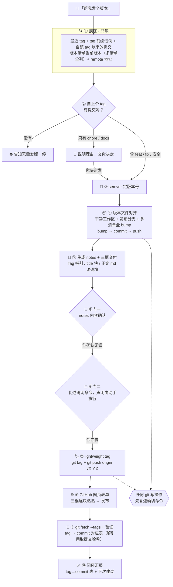

<div align="center">

# 🚀 release-assistant

**把「发版」从一堆容易漏的手工步骤，变成一条可验证的闭环**

*Semver-first · Local tag first · Three-block paste · Web-form publishing · Zero installs*

[](./Release-Assistant/SKILL.md)
[](https://www.markdownguide.org/)
[](https://git-scm.com/)
[](https://semver.org/)
[](https://docs.github.com/en/repositories/releasing-projects-on-github)
[](#-快速开始)
[](./LICENSE)

[快速开始](#-快速开始) · [为什么需要它](#-为什么需要它) · [发版闭环](#-一次发版的完整闭环) · [核心机制](#-核心机制拆解) · [项目结构](#-项目结构)

</div>

---

> ### 🧷 发版难的从来不是「点发布」，而是发布之前那一串没人替你记的细节
> tag 打在没有升版本号的那条提交上、`git push` 推了代码却没推 tag、网页建完 tag 忘了 `fetch`、
> release notes 里的短 hash 是凭印象写的、复制到正文框的是渲染后的文本而不是 md 源码、
> 顺手 `winget install gh` 就为了一个下拉框……
>
> **release-assistant 把这些细节钉成 10 步流水线**：判断该不该发 → 按 semver 定版本号 → 版本文件对齐 → 写 release notes → **三框交付**（Tag / Release title / 正文逐块可粘贴）→ 两道确认闸门 → 打 tag → 网页发布 → 同步验证 → 闭环汇报。
> 它不装任何软件、不改你的业务代码；git 写操作经你确认后**由助手执行**，从不丢给你手敲。

---

## ✨ 为什么需要它

发版翻车不是能力问题，是流程问题。四个最常见的坑，对应技能里四条硬约束：

| 💥 常见翻车 | 后果 | 本技能的对应机制 |
|---|---|---|
| 版本文件还是 `1.2.0`，tag 却打了 `v1.3.0` | tag 与清单版本**永久悬空**，包管理器与源码对不上 | **版本号对齐**：先 bump 版本文件 → commit → push，再把 tag 打在「版本号升级」这条提交上（`SKILL.md` 步骤 4） |
| 打完本地 tag 只跑了 `git push` | 裸 `git push` **不推送 tag 引用**，GitHub 上根本没有这个 tag | **本地 tag 先行**：`git tag vX.Y.Z` + 显式 `git push origin vX.Y.Z`（`SKILL.md` 步骤 7） |
| 把聊天里的渲染文本粘进正文框 | 粗体、标题全是排版结果，GitHub 上笔记面目全非 | **三框交付契约**：正文以 **md 源码**装在 4 反引号围栏里交付，Tag / title / 正文逐块对应三个表单项（`release-notes-format.md`） |
| 在网页新建 tag 发布，本地毫无感知 | 本地 tag 列表落后，后续 `describe` 全乱 | **发布后同步**：`git fetch --tags` + `tag → commit` 对应表逐条核对（`SKILL.md` 步骤 9） |

> 💡 它的定位很窄：**只做「tag 前最后一公里」**。commit message 归 `commit-message-assistant`，npm publish 与 CI 不归它管。

---

## 🏗️ 一次发版的完整闭环



---

## 🧩 四大设计原则

|  | 🎯 对齐先于打 tag | 📦 三框逐块可粘贴 | 🔓 零安装、权在你手 | 🔍 可验证，不靠假设 |
| :---: | :--- | :--- | :--- | :--- |
| **做法** | 版本号升级单独成一次提交，tag 必须指向它；bump 前查干净工作区与发布分支，多清单并存全部 bump | Tag 框给指引、title 与正文**各自独立成块**、正文是 md 源码装在 4 反引号围栏里，附「Generate release notes 按钮勿点」警告 | 不装 `gh`、不装任何 CLI，发布动作由你在网页点；git 写操作经复述确认后由助手执行，绝不丢给你手敲 | 短 hash 逐条回 `git log` 核对；tag 一律 lightweight，验证用解引用格式；发布后 `fetch` 并用 `tag → commit` 对应表验证 |
| **解决** | tag 与版本号悬空、`v1.3.0` 的代码里写着 `1.2.0` | 渲染文本粘坏正文、title 混进正文、误点自动生成覆盖手写 notes | 为了填一个下拉框污染开发环境；写操作落谁头上说不清 | 「我以为发布了」——标签指向错提交却无人发现 |

---

## 🎯 功能全景

- ⚖️ **发版必要性判断** —— 用提交证据回答「要不要发版本」：无提交直接停、仅 chore 交你决定、有 feat/fix/安全才建议发
- 📐 **semver 判定树** —— 破坏性变更升 major、有 feat 升 minor、仅 fix/chore 升 patch，0.x 阶段谨慎升 major
- 📦 **版本号对齐** —— bump 前三查：工作区干净（`git status --porcelain`）、当前分支是发布分支、多版本清单并存全部 bump；经同意后 commit + push
- 🏷️ **tag 策略二选一** —— 推荐「本地 tag 先行 + 显式推送 tag 引用」；也覆盖「网页建 tag + 事后 fetch」路径；tag 一律 **lightweight**，前缀跟随仓库既有惯例（无历史默认 `v`）
- 📦 **三框交付契约** —— Tag 框给选法指引、Release title 独立成块、Describe 正文以 **md 源码**装进 4 反引号围栏逐块交付，粘贴即发
- 🚧 **两道确认闸门** —— 闸门一：notes 内容确认后才谈 tag；闸门二：单独复述确切命令、声明由助手执行，拿到同意才动手
- 📝 **可粘贴的 release notes** —— 按 `Release-Assistant/references/release-notes-format.md` 的规范分组，**破坏性变更节永远第一节**（变了什么/影响谁/怎么迁移），安全加固单独置顶，每条带真实短 hash
- 📦 **安装/升级节** —— 库/CLI 项目自动附一条升级命令（`pip install -U pkg==X.Y.Z`），Web 应用项目整节省略
- 🔗 **Full Changelog 链接** —— 自动拼 `<prev-tag>...<new-tag>`，首次发版改用 `/commits/<tag>` 形式
- 🧾 **表单填写指引** —— Tag 选法、Release label（正式/预发行）、附件区留空、Packages 区跳过、**Generate release notes 按钮勿点**（会整段覆盖手写 notes），逐项给结论
- 🔄 **发布后同步验证** —— `git fetch --tags`（失败先查网络/代理，重试至多一次）+ `tag → commit` 对应表（`%(*objectname:short)` 解引用，annotated 历史标签也返回提交哈希）
- 🔐 **写操作护栏** —— commit / push / tag 执行前必须复述确切命令并获同意，由助手执行；不改业务代码，只动版本号文件与 git 元数据
- 🚫 **拒绝装工具** —— 用户提议装 `gh`/`winget` 时改走网页表单；任何安装须单次单独批准

---

## 🔬 核心机制拆解

### 🏷️ 为什么 tag 必须打在「版本号升级」这条提交上

tag 只是一个指针，它**不会**帮你改 `package.json`。若版本文件与 tag 指向的提交不一致，任何 `npm view` / `pip index` / `cargo search` 都会报出错的版本号：

```
❌ 悬空（错误）
   a1b2c3d   feat: 新增导出           ← tag v1.3.0 指向这里
   ─────────────────────────────────
   package.json: "version": "1.2.0"   ← 代码里还是旧版本号

✅ 对齐（技能的做法）
   e4f5g6h   chore: bump version to 1.3.0   ← tag v1.3.0 指向这里
   a1b2c3d   feat: 新增导出
   ─────────────────────────────────
   package.json: "version": "1.3.0"   ← tag、清单、代码三者一致
```

因此 `SKILL.md` 步骤 4 的顺序固定为 **三查 → bump → commit → push → 打 tag**，并在 Validation 里用「新 tag 指向的提交 = 版本号升级提交」作为发布完成的判定条件。

### 📦 三框交付契约：为什么是三个块，而不是一段话

GitHub 网页发布表单有三个要填的框：**Tag、Release title、Describe this release**。契约让每个框拿到的东西逐块对应、原样可粘：

```
① Tag 框        → 一句选法指引（下拉选已有 tag / 输入新 tag 建 tag）
② Release title → 独立代码块：v1.2.0 · 一句话主题
③ 正文          → 独立代码块：完整 md 源码（4 反引号围栏包裹）
```

两个容易翻车的细节，契约里各有一条硬规则：

- **正文必须是 md 源码，不是渲染文本**。聊天窗口里直接输出的 markdown 会被渲染成粗体和标题，复制到的是排版结果，粘进 GitHub 就面目全非。所以 ③ 永远装在 4 反引号围栏里交付。
- **为什么外层围栏是 4 反引号**：正文内部一旦出现代码块（如安装命令，3 反引号），外层围栏若也是 3 反引号就会被击穿，用户复制到一半截断。契约规定**外层 4 反引号、正文内嵌代码块最多 3 反引号**，嵌套永远安全。

另附一条表单警告：粘贴正文后**不要点「Generate release notes」按钮**——它会用自动生成内容整段覆盖你粘贴的手写 notes。

<details>
<summary><b>📄 三框交付实例（点击展开）</b></summary>

> 实际交付时，外层围栏是 4 反引号，下面为了能嵌套展示用了 5 反引号示意层级：

`````markdown
以下三块对应网页表单三个填写项，逐块复制粘贴。
⚠️ 粘贴正文后切勿点击「Generate release notes」按钮——它会覆盖你粘贴的手写 notes。

① Tag 框：在下拉中选 v1.3.0（已推送，无需 fetch）

② Release title 框（整块复制）：
```
v1.3.0 · 双引擎加固与老格式兼容
```

③ Describe this release 框（Markdown 源码，整块复制）：
```markdown
v1.2.0 之后的第一个迭代，聚焦导出链路可靠性与本地服务安全加固。

## ✨ 新功能
- **nbformat v3 老格式完整支持**（`90be17c`）：更多老笔记本可以直接转换

## 🔒 安全加固
- **本地 PDF 服务请求校验加固**（`d4f9301`）：防 DNS rebinding 与恶意调用

## 🐛 修复
- **导出偶发卡死**（`a1b2c3d`）：大文件转换不再中断

**Full Changelog**: https://github.com/WeatherCore/ipynb-to-pdf/compare/v1.2.0...v1.3.0
```
`````

</details>

### 📝 Release notes 的分组与措辞规则

`Release-Assistant/references/release-notes-format.md` 是 notes 的唯一权威，生成前必读。核心六条：

| 规则 | 具体要求 |
|---|---|
| 🎯 用户视角优先 | 写「用户得到什么 / 不再遇到什么」，实现细节只用作反引号后缀（如 `src/render.ts`） |
| ⚠️ 破坏性变更第一节 | 永远在开场之后、安全加固之前；每条三要素——变了什么 / 影响谁 / 怎么迁移，一行写完 |
| 🔒 安全置顶 | 有安全改动必须单独成节、位置靠前；一批全是安全修复时标题也可点明 |
| #️⃣ 短 hash 真实 | 每个引用的 hash 从 `git log --oneline <tag>..HEAD` 原样摘取，生成前逐一核对 |
| 🧹 其他类收敛 | docs/chore/deps 合并概括成短条目，不逐条复读 commit message；优先每节 3–5 条，超了合并同类项（软规则，安全与破坏性条目永不省略） |
| 🔗 compare 链接 | `https://github.com/<owner>/<repo>/compare/<prev-tag>...<new-tag>`，首次发版用 `/commits/<tag>` |

merge/squash 仓库的条目规则：提交尾缀 `(#N)` 原样保留（GitHub 自动渲染成 PR 链接）；`Merge pull request #N` 用 PR 标题入组、hash 取 merge commit；squash 大提交允许组内拆多条 bullet。

<details>
<summary><b>📄 notes 模板（点击展开，与 Release-Assistant/references/release-notes-format.md 一致）</b></summary>

```markdown
<一两句开场>

## ⚠️ 破坏性变更            ← 仅在有破坏性变更时出现，永远第一节
- **<变了什么>**（`<短hash>`）：影响<谁>——迁移：<一行说清怎么改>

## 🔒 安全加固              ← 仅在有安全改动时出现
- **<加固点>**（`<短hash>`）：<影响谁、防什么>

## ✨ 新功能
- **<特性名>**（`<短hash>`）：<一句用户视角的价值说明>

## 🐛 修复
- **<症状>**（`<短hash>`）：<修复后的行为>

## 📝 其他
- <docs/chore/deps 类，合并成短条目>

## 📦 安装/升级            ← 仅库/CLI 项目出现
<一条命令，如 pip install -U pkg==X.Y.Z>

**Full Changelog**: https://github.com/<owner>/<repo>/compare/<prev-tag>...<new-tag>
```

> 空节整节省略；标题行 `v<版本> · <主题>` 只进 Release title 框，**永不进正文**。

</details>

### 🔐 两道闸门：写操作前复述命令、由助手执行

技能的全部 git 写操作走两道闸门——**先确认内容，再确认命令**，且命令由助手执行，不丢给用户手敲：

```
闸门一（notes 确认）
你：帮我发个 v1.3.0
技能：[交付三框] → 以上三块请确认无误，确认后我再给出 tag 命令。

闸门二（tag 写操作，单独一条消息）
技能：接下来由我执行以下写操作，请确认：
      1) git tag v1.3.0
      2) git push origin v1.3.0
      确认后我来执行；任一步失败不会自动盲重试（重试至多一次）。
你：确认
技能：[执行并回报结果]
```

同时：不改业务代码（只动版本号文件与 git 元数据）、不安装任何软件、不改你的 CI / npm 发布流程。

---

## 🧰 构成与技术约束

| 分类 | 构成 |
|---|---|
| **形态** | 纯提示词技能（Prompt-only Skill）：两份 Markdown，**无可执行代码、无依赖、无构建步骤** |
| **触发机制** | `SKILL.md` frontmatter 的 `description` 决定何时加载——内含触发词（发版 / Release / 版本号 / tag）与排除项（commit message、npm publish、CI） |
| **运行宿主** | DeepSeek Harness（DSH），技能目录 `~/.dsh/skills/` |
| **外部工具** | `git`（只读命令自由执行，写命令需两道闸门确认后由助手执行）、GitHub 网页表单（发布动作由**人**执行） |
| **版本口径** | SemVer 2.0.0：破坏性 → major · feat → minor · fix/chore → patch · 0.x 谨慎升 major |
| **明确不引入** | `gh` CLI、任何安装器、CI 配置、包管理器发布流程 |

---

## 🚀 快速开始

### 0️⃣ 环境要求

| 组件 | 要求 | 说明 |
|---|---|---|
| DeepSeek Harness（DSH） | 已安装并可使用技能 | 技能的运行宿主 |
| Git | 2.x+，且目标目录是 git 仓库 | 非仓库时技能会告知并停止 |
| 远端仓库 | GitHub，且有 push 权限 | 用于网页表单发布与 tag 同步 |
| 版本清单文件 | `package.json` / `pyproject.toml` / `Cargo.toml` 等任一 | 读取当前版本、执行 bump；多清单并存时全部 bump |
| `gh` CLI | ❌ **不需要** | 技能明确拒绝安装，改走网页表单 |

### 1️⃣ 安装技能

DSH 从用户级技能目录加载技能，把仓库里的 `Release-Assistant/` 文件夹整个复制进去即可（**无编译、无依赖、无安装脚本**）；目标目录名建议保持 `release-assistant`，与 `SKILL.md` frontmatter 的 `name` 一致：

```powershell
# Windows PowerShell（在本仓库根目录执行）
New-Item -ItemType Directory -Force "$env:USERPROFILE\.dsh\skills" | Out-Null
Copy-Item -Recurse -Force .\Release-Assistant "$env:USERPROFILE\.dsh\skills\release-assistant"
Test-Path "$env:USERPROFILE\.dsh\skills\release-assistant\SKILL.md"   # 期望输出 True
```

```bash
# macOS / Linux
mkdir -p ~/.dsh/skills
cp -r ./Release-Assistant ~/.dsh/skills/release-assistant
ls ~/.dsh/skills/release-assistant/SKILL.md
```

### 2️⃣ 触发它

在对话里直接说，或用技能选择器点 `/release-assistant`：

| 想做的事 | 你可以这样说 |
|---|---|
| 让技能判断该不该发 | 「要不要发个版本？」「这个项目该发版吗」 |
| 直接走发布流程 | 「帮我发个版本」「发布 Release」 |
| 只要文案 | 「写 release notes」「生成发行说明」 |
| 只升版本号 | 「版本号升一下」「打个 tag」 |

### 3️⃣ 发版前自检（纯只读，可安全执行）

```bash
# 最近一个 tag（没有输出 = 仓库还没有 tag，属首次发版）
git tag -l --sort=-creatordate

# 自上个 tag 以来的提交（有 tag 时）
git log --oneline "$(git describe --tags --abbrev=0)..HEAD"
# 尚无 tag 时，先看最近 30 条历史
git log --oneline -30

# 确认远端与主干分支
git remote -v
git branch --show-current
```

### 4️⃣ 让它走完一次闭环

```
你：帮我发个版本

技能：① 摸底（tag / tag 前缀惯例 / 提交 / 版本清单 / remote，只读）
     → ② 判断有无值得发的提交（无提交就停）
     → ③ 建议 semver 版本号（给你证据，等你确认）
     → ④ 版本号对齐（三查 + 复述命令，等你确认后才 commit + push）
     → ⑤ 生成 release notes + 三框交付（Tag 指引 / title 块 / 正文 md 源码块）
     → 🚧 闸门一：等你确认 notes 内容无误
     → 🚧 闸门二：单独复述 tag 命令、声明由助手执行，等你同意
     → ⑦ 打 lightweight tag → ⑧ 网页表单三框逐块粘贴发布
     → ⑨ git fetch --tags + tag→commit 对应表验证
     → ⑩ 闭环汇报（tag→commit 表 + 下次走本地 tag 先行的提醒）
```

网页表单由**你自己**操作：技能把三个框的内容逐块给你，你复制粘贴后点发布。

### 5️⃣ 验收：确认 tag 指向正确

```bash
# 新 tag 指向的提交主题应是「版本号升级」那条
git log v1.3.0 -1 --oneline

# 全量 tag → commit 对应表（解引用格式：annotated tag 也返回提交哈希）
git tag -l --format='%(refname:short) -> %(*objectname:short) %(subject)'

# 确认 tag 是 lightweight（输出 commit 才对；输出 tag 说明是 annotated）
git cat-file -t v1.3.0
```

<details>
<summary><b>🌐 网页发布表单速查（点击展开）</b></summary>

| 表单字段 | 填什么 | 备注 |
|---|---|---|
| **Tag** | 本地 tag 先行 → 下拉选**已有 tag**；否则输入新 tag 名 → create new tag → 目标 = 主分支 | 网页建 tag 时，发布后必须补 `git fetch --tags` |
| **Release title** | 技能交付的 ② 号块原样粘贴：`v<版本> · <一句话主题>` | 不写日期，GitHub 已自带 |
| **Describe this release** | 技能交付的 ③ 号块原样粘贴（md 源码） | 粘贴后**勿点「Generate release notes」**——会整段覆盖手写 notes |
| **Release label** | 正式版选「无」；实验/预览版选「预发行版」 | — |
| **Attach files** | 一般留空 | Web 应用不需要附加二进制 |
| **包 / Packages 区** | 跳过 | 那是发 npm / 容器包用的 |

</details>

<details>
<summary><b>🧯 常见问题（点击展开）</b></summary>

| 症状 | 原因 | 处理 |
|---|---|---|
| GitHub 上看不到刚打的 tag | 只跑了裸 `git push`，tag 引用没推 | `git push origin vX.Y.Z` 显式推送 tag |
| 网页发布后本地 `git tag -l` 里没有新 tag | tag 由 GitHub 创建，本地未同步 | `git fetch --tags` |
| `git fetch --tags` 超时 | 网络 / 代理 | 先查网络与代理，重试**至多一次**，不盲试 |
| 版本号与 tag 不一致 | 跳过了版本号对齐步骤 | 重新 bump → commit → push，再移动 tag |
| 粘贴的 notes 显示成一大段纯文本 | 复制到的是聊天里的渲染文本，不是 md 源码 | 用三框交付的 ③ 号块（4 反引号围栏内的源码）重新粘贴 |
| 手写 notes 被自动内容覆盖 | 粘贴后误点了「Generate release notes」 | 删掉正文重新粘贴 ③ 号块，不要点该按钮 |
| tag→commit 表里某行哈希与 `git log` 对不上 | 该 tag 是 annotated，未解引用时显示 tag 对象哈希 | 用 `%(*objectname:short)` 解引用格式；本技能打的 tag 一律 lightweight |
| 想装 `gh` 图省事 | 需求本身合理但非必需 | 技能会改走网页表单；如确要安装，需你单独批准 |

</details>

---

## 📁 项目结构

```
release-assistant/                    # 📦 仓库根 = 门面 + 技能本体
├── README.md                         # 🚀 项目门面（本文档）
├── Description.md                    # 🪪 项目名片：中文版（≤350 字符，贴 GitHub About）+ 英文版
├── LICENSE                           # ⚖️ MIT License
├── .gitignore                        # 🧹 标准 Python 忽略模板
└── Release-Assistant/                # 🧠 技能本体：安装时整个文件夹复制到 ~/.dsh/skills/release-assistant
    ├── SKILL.md                      #    Goal / 10 步 Workflow（含两道闸门）/ Decision Tree / Constraints / Validation / Resources
    └── references/
        └── release-notes-format.md   #    notes 唯一权威：分组结构 · 三框交付契约 · 措辞规则 · compare 链接 · 表单指引 · 实例
```

<details>
<summary><b>📖 技能本体的两个文件分别管什么（点击展开）</b></summary>

| 文件 | 内容 | 何时被读 |
|---|---|---|
| `Release-Assistant/SKILL.md` | 触发描述（frontmatter `description`）、目标、10 步工作流（含两道闸门）、决策树、红线约束、验收标准 | 技能加载时**必读**——这是流程与边界的唯一出处 |
| `Release-Assistant/references/release-notes-format.md` | 标题惯例、正文结构（破坏性变更/安全/新功能/修复/其他/安装）、分组与措辞规则、三框交付契约、网页表单填写指引、真实节选示例 | 生成 release notes **前**必读（`SKILL.md` 步骤 5 显式指向） |

> 📌 两个文件都是 Markdown 提示词，**没有任何可执行代码**——技能的行为完全由这两份文档定义，改文档即改行为。

</details>

---

## 🧭 边界：它不做什么

| 不属于它的活 | 该交给谁 |
|---|---|
| 写 commit message / 提交备注 | `commit-message-assistant` 技能 |
| `npm publish` 发包 | npm 工具链（技能只处理 GitHub Release，不碰包仓库） |
| 搭建 CI / CD 发布流水线 | 各自的 CI 配置（GitHub Actions 等） |
| 安装 `gh`、`winget` 等任何工具 | ❌ 一律拒绝，改走网页表单 |
| 代替你点击「发布」 | 网页表单由**你自己**操作 |
| 修复代码、重构实现 | 只动版本号文件与 git 元数据，不改业务代码 |

---

## 🗺️ Roadmap

- [x] 10 步发版闭环（摸底 → 判定 → 定版 → 对齐 → notes → 三框交付 → 双闸门 → tag → 发布 → 验证）
- [x] semver 判定树，含 0.x 阶段谨慎升 major
- [x] 本地 tag 先行 + 显式推送 tag 引用（规避裸 `git push` 不带 tag）
- [x] **三框交付契约**：Tag 指引 / Release title / 正文 md 源码逐块可粘贴，4 反引号围栏防嵌套击穿
- [x] **两道确认闸门**：notes 内容确认与 tag 命令确认分离，写操作由助手执行
- [x] notes 规范 v2：破坏性变更节（三要素）置顶、安全加固单独成节、安装/升级节（库/CLI）、短 hash 逐一核对、compare 链接模板、merge/squash 条目规则
- [x] 网页表单填写指引（Tag / title / 正文 / label / 附件 / Packages 区 / Generate 按钮警告）
- [x] 发布后 `git fetch --tags` + 解引用 `tag → commit` 对应表验证（`%(*objectname:short)`）
- [x] lightweight tag 硬约束 + tag 前缀跟随仓库惯例
- [ ] 读取并合并既有 `CHANGELOG.md` 条目，避免与手写变更日志漂移
- [ ] monorepo 多包场景：按包分别定版本号与打 tag
- [ ] 预发行版（beta / rc）版本号演进策略模板

---

<div align="center">

## 🤝 参与贡献

**Fork → Branch → PR**。改流程请同步改 `Release-Assistant/SKILL.md` 的 Workflow 与 Validation，改文案请只动 `Release-Assistant/references/release-notes-format.md`。

> 发版这一步，值得比「点发布」更认真一点。

**如果这个技能帮你少踩一个 tag 的坑，欢迎 Star ⭐**

📜 本项目基于 [MIT License](./LICENSE) 开源 · © 2026 Weather-Report

</div>
