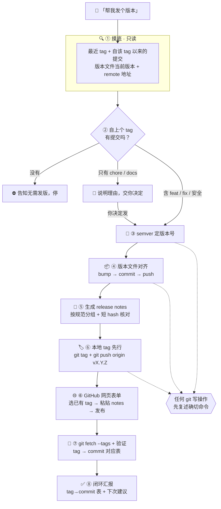

<div align="center">

# 🚀 release-assistant

**把「发版」从一堆容易漏的手工步骤，变成一条可验证的闭环**

*Semver-first · Local tag first · Web-form publishing · Zero installs*

[](./Release-Assistant/SKILL.md)
[](https://www.markdownguide.org/)
[](https://git-scm.com/)
[](https://semver.org/)
[](https://docs.github.com/en/repositories/releasing-projects-on-github)
[](#-快速开始)
[](./LICENSE)

[快速开始](#-快速开始) · [为什么需要它](#-为什么需要它) · [发版闭环](#-一次发版的完整闭环) · [核心机制](#-核心机制拆解) · [项目结构](#-项目结构)

</div>

---

> ### 🧷 发版难的从来不是「点发布」，而是发布之前那一串没人替你记的细节
> tag 打在没有升版本号的那条提交上、`git push` 推了代码却没推 tag、网页建完 tag 忘了 `fetch`、
> release notes 里的短 hash 是凭印象写的、顺手 `winget install gh` 就为了一个下拉框……
>
> **release-assistant 把这些细节钉成 8 步流水线**：判断该不该发 → 按 semver 定版本号 → 版本文件对齐 → 写可直接粘贴的 release notes → 打 tag → 网页发布 → 同步验证 → 闭环汇报。
> 它不装任何软件、不改你的业务代码、不在未获同意时执行任何 git 写操作。

---

## ✨ 为什么需要它

发版翻车不是能力问题，是流程问题。三个最常见的坑，对应技能里三条硬约束：

| 💥 常见翻车 | 后果 | 本技能的对应机制 |
|---|---|---|
| 版本文件还是 `1.2.0`，tag 却打了 `v1.3.0` | tag 与清单版本**永久悬空**，包管理器与源码对不上 | **版本号对齐**：先 bump 版本文件 → commit → push，再把 tag 打在「版本号升级」这条提交上（`SKILL.md` 步骤 4–5） |
| 打完本地 tag 只跑了 `git push` | 裸 `git push` **不推送 tag 引用**，GitHub 上根本没有这个 tag | **本地 tag 先行**：`git tag vX.Y.Z` + 显式 `git push origin vX.Y.Z`（`SKILL.md` 步骤 6） |
| 在网页新建 tag 发布，本地毫无感知 | 本地 tag 列表落后，后续 `describe` 全乱 | **发布后同步**：`git fetch --tags` + `tag → commit` 对应表逐条核对（`SKILL.md` 步骤 7） |

> 💡 它的定位很窄：**只做「tag 前最后一公里」**。commit message 归 `commit-message-assistant`，npm publish 与 CI 不归它管。

---

## 🏗️ 一次发版的完整闭环



---

## 🧩 三大设计原则

|  | 🎯 对齐先于打 tag | 🔓 零安装、权在你手 | 🔍 可验证，不靠假设 |
| :---: | :--- | :--- | :--- |
| **做法** | 版本号升级单独成一次提交，tag 必须指向它；清单版本 ≠ 目标版本时先对齐再打 | 不装 `gh`、不装任何 CLI，release notes 与表单字段逐段可粘贴，发布动作由你在网页点 | 短 hash 逐条回 `git log` 核对；发布后 `fetch` 并用 `tag → commit` 对应表验证 |
| **解决** | tag 与版本号悬空、`v1.3.0` 的代码里写着 `1.2.0` | 为了填一个下拉框污染开发环境；把发布权交出去 | 「我以为发布了」——标签指向错提交却无人发现 |

---

## 🎯 功能全景

- ⚖️ **发版必要性判断** —— 用提交证据回答「要不要发版本」：无提交直接停、仅 chore 交你决定、有 feat/fix/安全才建议发
- 📐 **semver 判定树** —— 破坏性变更升 major、有 feat 升 minor、仅 fix/chore 升 patch，0.x 阶段谨慎升 major
- 📦 **版本号对齐** —— 提议 bump `package.json` / `pyproject.toml` / `Cargo.toml`，经同意后才 commit + push
- 🏷️ **tag 策略二选一** —— 推荐「本地 tag 先行 + 显式推送 tag 引用」；也覆盖「网页建 tag + 事后 fetch」路径
- 📝 **可粘贴的 release notes** —— 按 `Release-Assistant/references/release-notes-format.md` 的规范分组，安全加固单独置顶成节，每条带真实短 hash
- 🔗 **Full Changelog 链接** —— 自动拼 `<prev-tag>...<new-tag>`，首次发版改用 `/commits/<tag>` 形式
- 🧾 **表单填写指引** —— Tag 选法、Release label（正式/预发行）、附件区留空、Packages 区跳过，逐项给结论
- 🔄 **发布后同步验证** —— `git fetch --tags`（失败先查网络/代理，重试至多一次）+ `tag → commit` 对应表
- 🔐 **写操作护栏** —— commit / push / tag 执行前必须复述确切命令并获同意；不改业务代码，只动版本号文件与 git 元数据
- 🚫 **拒绝装工具** —— 用户提议装 `gh`/`winget` 时改走网页表单；任何安装须单次单独批准

---

## 🔬 核心机制拆解

### 🏷️ 为什么 tag 必须打在「版本号升级」这条提交上

tag 只是一个指针，它**不会**帮你改 `package.json`。若版本文件与 tag 指向的提交不一致，任何 `npm view` / `pip index` / `cargo search` 都会报出错的版本号：

```
❌ 悬空（错误）
   a1b2c3d   feat: 新增导出           ← tag v1.3.0 指向这里
   ─────────────────────────────────
   package.json: "version": "1.2.0"   ← 代码里还是旧版本号

✅ 对齐（技能的做法）
   e4f5g6h   chore: bump version to 1.3.0   ← tag v1.3.0 指向这里
   a1b2c3d   feat: 新增导出
   ─────────────────────────────────
   package.json: "version": "1.3.0"   ← tag、清单、代码三者一致
```

因此 `SKILL.md` 步骤 4 的顺序固定为 **bump → commit → push → 打 tag**，并在 Validation 里用「新 tag 指向的提交 = 版本号升级提交」作为发布完成的判定条件。

### 📝 Release notes 的分组与措辞规则

`Release-Assistant/references/release-notes-format.md` 是 notes 的唯一权威，生成前必读。核心五条：

| 规则 | 具体要求 |
|---|---|
| 🎯 用户视角优先 | 写「用户得到什么 / 不再遇到什么」，实现细节只用作反引号后缀（如 `src/render.ts`） |
| 🔒 安全置顶 | 有安全改动必须单独成节、位置靠前；一批全是安全修复时标题也可点明 |
| #️⃣ 短 hash 真实 | 每个引用的 hash 从 `git log --oneline <tag>..HEAD` 原样摘取，生成前逐一核对 |
| 🧹 其他类收敛 | docs/chore/deps 合并概括成短条目，不逐条复读 commit message |
| 🔗 compare 链接 | `https://github.com/<owner>/<repo>/compare/<prev-tag>...<new-tag>`，首次发版用 `/commits/<tag>` |

<details>
<summary><b>📄 notes 模板（点击展开，与 Release-Assistant/references/release-notes-format.md 一致）</b></summary>

```markdown
v<版本> · <一句话主题>

<一两句开场：这个版本是什么定位，一句话说清对用户的最大变化。>

## ✨ 新功能
- **<特性名>**（`<短hash>`）：<一句用户视角的价值说明，可带代码位置>

## 🔒 安全加固
- **<加固点>**（`<短hash>`）：<影响谁、防什么>

## 🐛 修复
- **<症状>**（`<短hash>`）：<修复后的行为>

## 📝 其他
- <docs/chore/deps 类，合并成短条目>

**Full Changelog**: https://github.com/<owner>/<repo>/compare/<prev-tag>...<new-tag>
```

</details>

### 🔐 权限边界：写操作前复述命令

技能的全部 git 写操作都走同一条闸门——**先把确切命令原样复述给你，拿到同意才执行**：

```
你：帮我发个 v1.3.0

技能：将执行以下写操作，请确认：
      1) git add package.json && git commit -m "chore: bump version to 1.3.0"
      2) git push
      3) git tag v1.3.0
      4) git push origin v1.3.0
      确认后我再执行；任一步失败不会自动盲重试（重试至多一次）。
```

同时：不改业务代码（只动版本号文件与 git 元数据）、不安装任何软件、不改你的 CI / npm 发布流程。

---

## 🧰 构成与技术约束

| 分类 | 构成 |
|---|---|
| **形态** | 纯提示词技能（Prompt-only Skill）：两份 Markdown，**无可执行代码、无依赖、无构建步骤** |
| **触发机制** | `SKILL.md` frontmatter 的 `description` 决定何时加载——内含触发词（发版 / Release / 版本号 / tag）与排除项（commit message、npm publish、CI） |
| **运行宿主** | DeepSeek Harness（DSH），技能目录 `~/.dsh/skills/` |
| **外部工具** | `git`（只读命令自由执行，写命令需同意）、GitHub 网页表单（发布动作由**人**执行） |
| **版本口径** | SemVer 2.0.0：破坏性 → major · feat → minor · fix/chore → patch · 0.x 谨慎升 major |
| **明确不引入** | `gh` CLI、任何安装器、CI 配置、包管理器发布流程 |

---

## 🚀 快速开始

### 0️⃣ 环境要求

| 组件 | 要求 | 说明 |
|---|---|---|
| DeepSeek Harness（DSH） | 已安装并可使用技能 | 技能的运行宿主 |
| Git | 2.x+，且目标目录是 git 仓库 | 非仓库时技能会告知并停止 |
| 远端仓库 | GitHub，且有 push 权限 | 用于网页表单发布与 tag 同步 |
| 版本清单文件 | `package.json` / `pyproject.toml` / `Cargo.toml` 等任一 | 读取当前版本、执行 bump |
| `gh` CLI | ❌ **不需要** | 技能明确拒绝安装，改走网页表单 |

### 1️⃣ 安装技能

DSH 从用户级技能目录加载技能，把仓库里的 `Release-Assistant/` 文件夹整个复制进去即可（**无编译、无依赖、无安装脚本**）；目标目录名建议保持 `release-assistant`，与 `SKILL.md` frontmatter 的 `name` 一致：

```powershell
# Windows PowerShell（在本仓库根目录执行）
New-Item -ItemType Directory -Force "$env:USERPROFILE\.dsh\skills" | Out-Null
Copy-Item -Recurse -Force .\Release-Assistant "$env:USERPROFILE\.dsh\skills\release-assistant"
Test-Path "$env:USERPROFILE\.dsh\skills\release-assistant\SKILL.md"   # 期望输出 True
```

```bash
# macOS / Linux
mkdir -p ~/.dsh/skills
cp -r ./Release-Assistant ~/.dsh/skills/release-assistant
ls ~/.dsh/skills/release-assistant/SKILL.md
```

### 2️⃣ 触发它

在对话里直接说，或用技能选择器点 `/release-assistant`：

| 想做的事 | 你可以这样说 |
|---|---|
| 让技能判断该不该发 | 「要不要发个版本？」「这个项目该发版吗」 |
| 直接走发布流程 | 「帮我发个版本」「发布 Release」 |
| 只要文案 | 「写 release notes」「生成发行说明」 |
| 只升版本号 | 「版本号升一下」「打个 tag」 |

### 3️⃣ 发版前自检（纯只读，可安全执行）

```bash
# 最近一个 tag（没有输出 = 仓库还没有 tag，属首次发版）
git tag -l --sort=-creatordate

# 自上个 tag 以来的提交（有 tag 时）
git log --oneline "$(git describe --tags --abbrev=0)..HEAD"
# 尚无 tag 时，先看最近 30 条历史
git log --oneline -30

# 确认远端与主干分支
git remote -v
git branch --show-current
```

### 4️⃣ 让它走完一次闭环

```
你：帮我发个版本

技能：① 摸底（tag / 提交 / 版本清单 / remote，只读）
     → ② 判断有无值得发的提交（无提交就停）
     → ③ 建议 semver 版本号（给你证据，等你确认）
     → ④ 版本号对齐（复述命令，等你确认后才 commit + push）
     → ⑤ 生成 release notes（分组 + 短 hash）
     → ⑥ 打 tag（复述命令，等你确认）→ 网页表单发布（选 tag + 粘贴 notes）
     → ⑦ git fetch --tags + tag→commit 对应表验证
     → ⑧ 闭环汇报（tag→commit 表 + 下次走本地 tag 先行的提醒）
```

网页表单由**你自己**操作：技能把 Tag、标题、正文、Release label、附件区该填什么逐项告诉你，你复制粘贴后点发布。

### 5️⃣ 验收：确认 tag 指向正确

```bash
# 新 tag 指向的提交主题应是「版本号升级」那条
git log v1.3.0 -1 --oneline

# 全量 tag → commit 对应表（技能闭环汇报的同一份证据）
git tag -l --format='%(refname:short) -> %(objectname:short) %(subject)'
```

<details>
<summary><b>🌐 网页发布表单速查（点击展开）</b></summary>

| 表单字段 | 填什么 | 备注 |
|---|---|---|
| **Tag** | 本地 tag 先行 → 下拉选**已有 tag**；否则输入新 tag 名 → create new tag → 目标 = 主分支 | 网页建 tag 时，发布后必须补 `git fetch --tags` |
| **Release title** | `v<版本> · <一句话主题>` | 不写日期，GitHub 已自带 |
| **Describe this release** | 直接粘贴技能生成的 notes 全文 | 含 Full Changelog 链接 |
| **Release label** | 正式版选「无」；实验/预览版选「预发行版」 | — |
| **Attach files** | 一般留空 | Web 应用不需要附加二进制 |
| **包 / Packages 区** | 跳过 | 那是发 npm / 容器包用的 |

</details>

<details>
<summary><b>🧯 常见问题（点击展开）</b></summary>

| 症状 | 原因 | 处理 |
|---|---|---|
| GitHub 上看不到刚打的 tag | 只跑了裸 `git push`，tag 引用没推 | `git push origin vX.Y.Z` 显式推送 tag |
| 网页发布后本地 `git tag -l` 里没有新 tag | tag 由 GitHub 创建，本地未同步 | `git fetch --tags` |
| `git fetch --tags` 超时 | 网络 / 代理 | 先查网络与代理，重试**至多一次**，不盲试 |
| 版本号与 tag 不一致 | 跳过了版本号对齐步骤 | 重新 bump → commit → push，再移动 tag |
| 想装 `gh` 图省事 | 需求本身合理但非必需 | 技能会改走网页表单；如确要安装，需你单独批准 |

</details>

---

## 📁 项目结构

```
release-assistant/                    # 📦 仓库根 = 门面 + 技能本体
├── README.md                         # 🚀 项目门面（本文档）
├── Description.md                    # 🪪 项目名片：中文版（≤350 字符，贴 GitHub About）+ 英文版
├── LICENSE                           # ⚖️ MIT License
├── .gitignore                        # 🧹 标准 Python 忽略模板
└── Release-Assistant/                # 🧠 技能本体：安装时整个文件夹复制到 ~/.dsh/skills/release-assistant
    ├── SKILL.md                      #    Goal / 8 步 Workflow / Decision Tree / Constraints / Validation / Resources
    └── references/
        └── release-notes-format.md   #    notes 唯一权威：标题惯例 · 正文结构 · 分组措辞 · compare 链接 · 表单指引 · 实例
```

<details>
<summary><b>📖 技能本体的两个文件分别管什么（点击展开）</b></summary>

| 文件 | 内容 | 何时被读 |
|---|---|---|
| `Release-Assistant/SKILL.md` | 触发描述（frontmatter `description`）、目标、8 步工作流、决策树、红线约束、验收标准 | 技能加载时**必读**——这是流程与边界的唯一出处 |
| `Release-Assistant/references/release-notes-format.md` | 标题惯例、正文五段结构、分组与措辞规则、网页表单填写指引、真实节选示例 | 生成 release notes **前**必读（`SKILL.md` 步骤 5 显式指向） |

> 📌 两个文件都是 Markdown 提示词，**没有任何可执行代码**——技能的行为完全由这两份文档定义，改文档即改行为。

</details>

---

## 🧭 边界：它不做什么

| 不属于它的活 | 该交给谁 |
|---|---|
| 写 commit message / 提交备注 | `commit-message-assistant` 技能 |
| `npm publish` 发包 | npm 工具链（技能只处理 GitHub Release，不碰包仓库） |
| 搭建 CI / CD 发布流水线 | 各自的 CI 配置（GitHub Actions 等） |
| 安装 `gh`、`winget` 等任何工具 | ❌ 一律拒绝，改走网页表单 |
| 代替你点击「发布」 | 网页表单由**你自己**操作 |
| 修复代码、重构实现 | 只动版本号文件与 git 元数据，不改业务代码 |

---

## 🗺️ Roadmap

- [x] 8 步发版闭环（摸底 → 判定 → 定版 → 对齐 → notes → tag → 发布 → 验证）
- [x] semver 判定树，含 0.x 阶段谨慎升 major
- [x] 本地 tag 先行 + 显式推送 tag 引用（规避裸 `git push` 不带 tag）
- [x] 网页表单填写指引（Tag / label / 附件 / Packages 区）
- [x] notes 规范：安全加固置顶、短 hash 逐一核对、compare 链接模板
- [x] 发布后 `git fetch --tags` + `tag → commit` 对应表验证
- [ ] 读取并合并既有 `CHANGELOG.md` 条目，避免与手写变更日志漂移
- [ ] monorepo 多包场景：按包分别定版本号与打 tag
- [ ] 预发行版（beta / rc）版本号演进策略模板

---

<div align="center">

## 🤝 参与贡献

**Fork → Branch → PR**。改流程请同步改 `Release-Assistant/SKILL.md` 的 Workflow 与 Validation，改文案请只动 `Release-Assistant/references/release-notes-format.md`。

> 发版这一步，值得比「点发布」更认真一点。

**如果这个技能帮你少踩一个 tag 的坑，欢迎 Star ⭐**

📜 本项目基于 [MIT License](./LICENSE) 开源 · © 2026 Weather-Report

</div>
